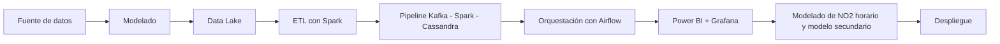

# Proyecto 4 - Big Data urbano (Valencia)

## Descripción y objetivo

El objetivo de este proyecto es construir un *pipeline* completo de ingeniería de datos (**batch + streaming**) sobre datos abiertos de **tráfico, calidad del aire y meteorología** de Valencia. Los datos se cruzan con **Spark** y el proyecto termina con dos modelos predictivos: uno principal de NO2 horario y uno secundario de intensidad de tráfico.

## Arquitectura

Arquitectura de dos vías (**streaming + batch**) que funcionan en paralelo y no deben interferir entre sí.

Tecnologías usadas:
- Spark
- Power BI
- Kafka
- Cassandra
- Grafana
- Airflow

## Fuente de datos

Tres APIs:
- Geoportal del Ayuntamiento de Valencia (ArcGIS REST)
- Portal de datos abiertos de Valencia (CKAN)
- AEMET OpenData

| Fuente | Que aporta | Acceso |
| --- | --- | --- |
| Geoportal del Ayuntamiento de Valencia | Tráfico: espiras (capa 208, vehículos/hora por punto de medida), tramos (capa 188) y estado del tráfico (capa 192, cada 3 min). Calidad del aire en tiempo real (capa 156, 11 estaciones) y meteo municipal (capa 157) | JSON, sin clave. Solo dan la foto del momento |
| Portal de datos abiertos de Valencia | Histórico horario de calidad del aire y meteo por estación, 2016–2022 | CSV / API CKAN |
| AEMET OpenData | Observación horaria de la estación 8416 (Valencia), solo las últimas ~24 h | API REST con API key gratuita |

| Fuente | URL / Origen | Formato | Frecuencia actualización | Licencia | Última ingesta |
| --- | --- | --- | --- | --- | --- |
| Geoportal del Ayuntamiento de Valencia | [URL] | JSON | [Frecuencia] | [Licencia] | [Fecha] |
| Portal de datos abiertos de Valencia | [URL] | CSV | [Frecuencia] | [Licencia] | [Fecha] |
| AEMET OpenData | [URL] | API REST | [Frecuencia] | [Licencia] | [Fecha] |

>[!NOTE]
La tabla de arriba no es definitivo, se irá actualizando a medida que avance el proyecto.

## Estructura del repositorio

Estas son las carpetas del repositorio:

| Carpeta | Contenido |
| --- | --- |
| dashboard/ | [dashboard] |
| etl | [etl] |
| ingesta | [ingesta] |

## Crear el entorno

Usaremos un entorno aislado para no tener conflictos con los paquetes.
`python -m venv .venv`

Lo activamos con:
`source .venv/bin/activate`

Lo desactivamos escribiendo `deactivate` en la terminal.

## Requisitos del proyecto

Los requisitos están recogidos en **requirements.txt**. Se instala con:
`pip install -r requirements.txt`

## Como desplegar el entorno

Con el **.env.example** que nos descargaremos, lo copiamos al que utiliza el repositorio.
`cp .env.example .env`

Levantamos los contenedores en modo *detached* con:
`docker compose up -d`

Para mirar que contenedores tenemos:
`docker compose ps`

Para parar el contenedor con:
>[!WARNING]
Perderemos los datos que no estén guardados en volumenes persistidos

`docker compose down`

## Bitácora de prácticas

> Cumplimentar al finalizar la práctica

### Bloque 0 - Entorno

- Objetivo: [ ]
- Pasos realizados: [ ]
- Problemas encontrados y solución: [ ]
- Resultado: [capturas, enlaces]

### Bloque 1 - Ingesta batch

- Objetivo: [ ]
- Pasos realizados: [ ]
- Problemas encontrados y solución: [ ]
- Resultado: [ ]

### Bloque 2 - Bases de datos NoSQL

- Objetivo: [ ]
- Pasos realizados: [ ]
- Problemas encontrados y solución: [ ]
- Resultado: [ ]

### Bloque 3 - Data Lake

- Objetivo: [ ]
- Pasos realizados: [ ]
- Problemas encontrados y solución: [ ]
- Resultado: [ ]

### Bloque 4 - Procesamiento con Spark

- Objetivo: [ ]
- Pasos realizados: [ ]
- Problemas encontrados y solución: [ ]
- Resultado: [ ]

### Bloque 5 - Streaming con Kafka

- Objetivo: [ ]
- Pasos realizados: [ ]
- Problemas encontrados y solución: [ ]
- Resultado: [ ]

<!--
### Bloque 6 - FIWARE e IoT

- Objetivo: [ ]
- Pasos realizados: [ ]
- Problemas encontrados y solución: [ ]
- Resultado: [ ]
-->

### Bloque 7 - Orquestación, calidad y gobierno

- Objetivo: [ ]
- Pasos realizados: [ ]
- Problemas encontrados y solución: [ ]
- Resultado: [ ]

| Nombre | Ubicación | Descripción | Esquema | Frecuencia | Responsable | Sensibilidad |
| --- | --- | --- | --- | --- | --- | --- |
| [tabla] | [ruta / colección] | [] | [] | [] | [] | [baja / media / alta] |

### Bloque 8 - Visualización

- Objetivo: [ ]
- Pasos realizados: [ ]
- Problemas encontrados y solución: [ ]
- Resultado: [ ]

### Bloque 9 - Inteligencia Artificial

- Objetivo: [ ]
- Pasos realizados: [ ]
- Problemas encontrados y solución: [ ]
- Resultado: [tabla de métricas]

### Bloque 10 - Nube

- Objetivo: [ ]
- Pasos realizados: [ ]
- Problemas encontrados y solución: [ ]
- Resultado: [ ]

### Decisiones técnicas

Las 2–3 decisiones de diseño más importantes, con la alternativa descartada. Te servirán para la defensa (Bloque 11, apartado 3).

| Decisión | Alternativa descartada | Motivo |
| --- | --- | --- |
| [] | [] | [] |

### Incidencias resueltas

| Problema | Causa | Solución |
| --- | --- | --- |
| [] | [] | [] |

## Resultado final

> Capturas del dashboard y del modelo, y enlace al vídeo o a la demo si la hay.