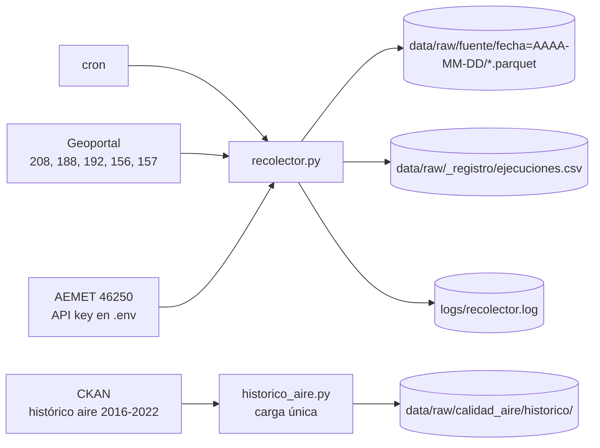

# Proyecto 4 - Big Data urbano (Valencia)

## Descripción y objetivo

El objetivo de este proyecto es construir un *pipeline* completo de ingeniería de datos (**batch + streaming**) sobre datos abiertos de **tráfico, calidad del aire y meteorología** de Valencia. Los datos se cruzan con **Spark** y el proyecto termina con dos modelos predictivos: uno principal de NO2 horario y uno secundario de intensidad de tráfico.

## Arquitectura

Arquitectura de dos vías (**streaming + batch**) que funcionan en paralelo y no deben interferir entre sí.

Tecnologías usadas:
- Spark
- Power BI
- Kafka
- Cassandra
- Grafana
- Airflow


## Fuentes de datos

El principal problema de este proyecto es que no existe ningún histórico público de tráfico en Valencia, ni de calidad del aire horaria a partir de 2023. El Geoportal solo nos da la foto del momento, así que el histórico lo tenemos que ir construyendo nosotros: un recolector programado con cron guarda esas fotos cada cierto tiempo. Si deja de ejecutarse unas horas, esos datos se pierden.

Usamos tres orígenes de datos:

| Fuente | Origen | Capa/endpoint | Clave | Frecuencia | Histórico |
| --- | --- | --- | --- | --- | --- |
| Tráfico | Geoportal Valencia (ArcGIS MapServer) | `Trafico/MapServer/208` | No | Se actualiza cada pocos minutos; lo ingestamos a diario | No, solo la foto actual |
| Calidad del aire | Geoportal Valencia (ArcGIS MapServer) | `MedioAmbiente/MapServer/156` | No | Se actualiza cada hora; lo ingestamos a diario | No, solo la foto actual |
| Meteorología | AEMET OpenData | `prediccion/especifica/municipio/diaria/46250` | Sí (`AEMET_API_KEY`) | Diaria | No. Las capturas se solapan y las deduplicaremos en el Bloque 4 |
| Histórico de aire 2016–2022 | Portal CKAN | API `datastore_search` | — | Una sola carga | Sí |

### URLs de acceso

**Tráfico**

https://geoportal.valencia.es/server/rest/services/OPENDATA/Trafico/MapServer/208/query?where=1=1&outFields=*&f=geojson

**Calidad del aire**

https://geoportal.valencia.es/server/rest/services/OPENDATA/MedioAmbiente/MapServer/156/query?where=1=1&outFields=*&f=geojson

**Meteorología (AEMET)**

AEMET funciona en dos pasos:
1. Hacemos una petición con la cabecera `api_key: <AEMET_API_KEY>` a https://opendata.aemet.es/opendata/api/prediccion/especifica/municipio/diaria/46250. El 46250 es el código INE de Valencia. Esta respuesta todavía no trae los datos: solo un JSON con `estado` y un campo `datos` que contiene otra URL.
2. Descargamos esa segunda URL (`peticion["datos"]`), que es la que devuelve la predicción.

La clave es personal y gratuita. Se pide en https://opendata.aemet.es/centrodedescargas/altaUsuario

### Parámetros de consulta del Geoportal

| Parámetro | Valor | Para qué sirve |
| --- | --- | --- |
| `where` | `1=1` | Es un filtro que siempre se cumple, así que devuelve todos los registros |
| `outFields` | `*` | Pide todos los campos |
| `f` | `geojson` | Formato de la respuesta. Si no lo ponemos, ArcGIS devuelve HTML o su propio JSON |

Para echar un vistazo sin descargarlo todo:
- Ver los campos y tipos de una capa: https://geoportal.valencia.es/server/rest/services/OPENDATA/Trafico/MapServer/208?f=pjson
- Traer solo 3 registros: añadimos `&resultRecordCount=3` a la URL de consulta.

### Otras capas que recoge el recolector

Además de las espiras, recogemos dos capas más de tráfico:

| | Espiras (208) | Tramos (188) | Estado (192) |
| --- | --- | --- | --- |
| Qué es | Un sensor en un punto | Un tramo de calle | Un tramo de calle |
| Qué mide | Vehículos/hora | Intensidad leída y media | Nivel de tráfico (categoría) |
| Geometría | Punto | Línea | Línea |
| Se actualiza | Cada hora | En tiempo real | Cada 3 min |

También recogemos la meteo municipal del Geoportal (`MedioAmbiente/MapServer/157`).

### Campos de cada fuente

#### Tráfico – capa 208

Hay un registro por cada punto de medida de la ciudad (1210 en la muestra). Cada registro es el estado actual del sensor, no una serie temporal, por eso el histórico lo vamos sacando de acumular ingestas.

| Campo | Tipo | Qué significa | Cómo lo usamos |
| --- | --- | --- | --- |
| `idpm` | entero | Identificador del punto de medida (1209 distintos en 1210 registros) | `punto_medida` |
| `ih` | entero / null | Intensidad en vehículos/hora. Un `-1` indica que el sensor no tiene dato y un `null` que no hay lectura | `intensidad` |
| `fecha_actualizacion` | epoch en milisegundos | Última vez que se actualizó el sensor | `timestamp` (UTC) |
| `hora_actualizacion` | null | Siempre vacío en los datos observados | — |
| `angulo` | entero (grados) | Orientación del tramo o sentido | No lo usamos |
| `gid`, `globalid` | entero / GUID | Identificadores internos de ArcGIS | No los usamos |
| `created_*`, `last_edited_*` | texto / epoch ms | Datos de auditoría (quién y cuándo editó el registro) | No los usamos |
| `fiwareid` | texto / null | Id de FIWARE, vacío en los 1210 registros | No lo usamos |
| `longitud`, `latitud` | decimal (WGS84) | Coordenadas, que salen al aplanar `geometry` | Para mapas |

Problemas de calidad que hemos visto en la muestra del 2026-09-23:
- 183 registros con `ih = null`: los descartaremos en la zona trusted (`dropna`).
- 60 registros con `ih = -1`: no tienen dato, así que los filtraremos en el ETL (`intensidad >= 0`).
- Los valores más habituales son 0, 60, 90, 180, 210, 330…

#### Calidad del aire – capa 156

Hay una fila por estación (11 en la muestra), con la última medición de cada contaminante.

| Campo | Tipo | Qué significa | Cómo lo usamos |
| --- | --- | --- | --- |
| `nombre` | texto | Nombre de la estación (Dr. Lluch, Cabanyal, Centro, Viveros…) | `estacion` |
| `no2` | número / null | Dióxido de nitrógeno (µg/m³) | `no2` |
| `pm10` | número / null | Partículas de menos de 10 µm (µg/m³) | `pm10` |
| `pm25` | número / null | Partículas de menos de 2,5 µm (µg/m³) | De momento no |
| `so2`, `o3`, `co` | número / null | SO₂, ozono y CO. Vacíos en la muestra porque la estación no los mide | No los usamos |
| `fecha_carg` | epoch en milisegundos | Momento en el que se cargó la medición | `timestamp` (UTC) |
| `calidad_am` | texto | Calidad del aire en texto ("Buena", "Razonablemente Buena"…) | No lo usamos |
| `tipozona` | texto | Urbana o suburbana | No lo usamos |
| `tipoemisio` | texto | Principal fuente de emisión (por ejemplo, tráfico) | No lo usamos |
| `parametros` | texto | Contaminantes que mide la estación | Solo informativo |
| `mediciones` | null | Siempre vacío en los datos observados | — |
| `direccion`, `objectid`, `fiwareid` | texto / entero | Dirección, id de ArcGIS e id de FIWARE | No los usamos |
| `longitud`, `latitud` | decimal (WGS84) | Coordenadas de la estación | Para mapas |

Hay que tener en cuenta que no todas las estaciones miden PM10 y PM2.5 (Boulevar Sur y Viveros los devuelven a null), así que al agregar hay que ignorar los nulos.

#### Meteorología – AEMET

Es la predicción por días para el municipio de Valencia. Llega como una sola respuesta con estructura anidada, no como una lista plana. Trae más campos (cielo, viento, humedad…), pero solo nos quedamos con estos:

| Campo | Qué significa | Cómo lo usamos |
| --- | --- | --- |
| `dia[].fecha` | Día de la predicción (nos quedamos con los 10 primeros caracteres) | `fecha` |
| `dia[].temperatura.maxima` | Temperatura máxima (°C) | `temperatura_maxima` |
| `dia[].temperatura.minima` | Temperatura mínima (°C) | `temperatura_minima` |
| `dia[].probPrecipitacion[periodo="00-24"].value` | Probabilidad de lluvia en todo el día (%) | `probabilidad_precipitacion` |

Como cada ingesta trae varios días, cada ejecución genera varias filas.

#### Histórico de calidad del aire – CKAN

Es el histórico horario de calidad del aire, que también incluye variables meteorológicas de cada estación. Está publicado en el portal CKAN en dos recursos: 2016–2021 (unas 449.000 filas) y 2021–2022 (unas 201.000 filas). Lo descargamos una sola vez con la API `datastore_search`.

- Los dos ficheros usan formatos de fecha y hora distintos, y en algunas fechas el día y el mes están intercambiados.
- Guardamos todos los valores como texto, sin tocarlos; lo arreglaremos en el Bloque 4. Lo único que cambiamos son los nombres de las columnas (minúsculas, sin tildes ni espacios, por ejemplo `PM2.5` → `pm2_5`), para que Spark los lea sin problemas.

## Estructura del repositorio

Estas son las carpetas del repositorio:

| Carpeta | Contenido |
| --- | --- |
| dashboard/ | Vacío de momento |
| etl/ | Vacío de momento |
| ingesta/ | Script de carga única |
| recolector/ | Scripts de ingesta de Geoportal y AEMET |
| data/raw | Datos ingestados en .parquet |
| logs/ | Carpeta donde estarán los logs de las ejecuciones |


## Entorno

### Anclar la versión de python del entorno

Usamos pyenv para que siempre use la misma versión:
`pyenv local 3.14.4`

### Crear el entorno

Usaremos un entorno aislado para no tener conflictos con los paquetes.
`python -m venv .venv`

Lo activamos con:
`source .venv/bin/activate`

Lo desactivamos escribiendo `deactivate` en la terminal.

### Requisitos del proyecto

Los requisitos están recogidos en **requirements.txt**. Se instala con:
`pip install -r requirements.txt`

### Como desplegar el entorno

Con el **.env.example** que nos descargaremos, lo copiamos al que utiliza el repositorio y cumplimentamos los datos que sean necesarios.
`cp .env.example .env`

Levantamos los contenedores en modo *detached* con:
`docker compose up -d`

Para mirar que contenedores tenemos:
`docker compose ps`

Para parar el contenedor con:
>[!WARNING]
Perderemos los datos que no estén guardados en volumenes persistidos

`docker compose down`

## Bitácora de prácticas

> Cumplimentar al finalizar la práctica

### Bloque 0 - Entorno

- Objetivo: [ ]
- Pasos realizados: [ ]
- Problemas encontrados y solución: [ ]
- Resultado: [capturas, enlaces]

### Bloque 1 - Ingesta batch

- **Objetivo:** construir la ingesta batch del proyecto: un recolector que guarda cada cierto tiempo una foto de cada fuente (Geoportal y AEMET) programado con cron, y la carga única del histórico de calidad del aire 2016–2022.
- **Pasos realizados:**
  1. Exploración y documentación de las fuentes (sección *Fuentes de datos*).
  2. Estructura del proyecto: `recolector/`, `ingesta/`, `data/raw/`, `logs/` y entorno virtual con `requests`, `pyarrow` y `python-dotenv`.
  3. Descarga de las capas del Geoportal con reintentos (errores de red, 429 y 5xx) y paginación.
  4. Guardado de cada captura en Parquet particionado por fecha, con la columna `captura_utc`, y registro de cada ejecución en `data/raw/_registro/ejecuciones.csv`.
  5. Descarga de AEMET en dos pasos con la API key en el `.env`.
  6. Un único punto de entrada (`recolector.py <fuentes>`) en el que un fallo en una fuente no impide recoger las demás. Si alguna falla, el script termina con código 1.
  7. Programación con cron con una frecuencia distinta por fuente.
  8. Carga del histórico de aire: [pendiente]
- **Problemas encontrados y solución:** ver *Incidencias con las fuentes*.
- **Resultado:** el recolector se ejecuta con cron desde el 2026-11-08. Evidencia: captura de `crontab -l` y `data/raw/_registro/ejecuciones.csv`.  

#### Diagrama de la ingesta



#### Programación con cron

Cada fuente tiene su propia frecuencia, según lo rápido que cambia en origen:

| Fuente | Frecuencia | Por qué |
| --- | --- | --- |
| Estado del tráfico (192) | Cada 10 min | Se actualiza cada 3 min, es la que más cambia |
| Tramos (188) | Cada 15 min | Se actualiza en tiempo real; con 4 fotos por hora podemos sacar la media horaria |
| Espiras (208) | Cada hora (min 5) | Se actualiza cada hora y `ih` ya es intensidad horaria |
| Aire (156) y meteo municipal (157) | Cada hora (min 20) | Medición horaria; el minuto 20 deja margen a que se publique |
| AEMET | Diaria (07:30) | La predicción se actualiza una o pocas veces al día y cada llamada trae 7 días |

Aunque la tabla de fuentes dice "ingesta diaria", con una foto al día tendríamos un solo dato de NO₂ por estación y día, y el modelo del Bloque 9 es horario. Por eso subimos la frecuencia de tráfico y aire.

```cron
*/10 * * * * cd /home/qweidev/IABD/BigData/bigdata-p4-urbano && .venv/bin/python recolector/recolector.py estado >> logs/recolector.log 2>&1
*/15 * * * * cd /home/qweidev/IABD/BigData/bigdata-p4-urbano && .venv/bin/python recolector/recolector.py tramos >> logs/recolector.log 2>&1
5 * * * *    cd /home/qweidev/IABD/BigData/bigdata-p4-urbano && .venv/bin/python recolector/recolector.py espiras >> logs/recolector.log 2>&1
20 * * * *   cd /home/qweidev/IABD/BigData/bigdata-p4-urbano && .venv/bin/python recolector/recolector.py aire meteo >> logs/recolector.log 2>&1
30 7 * * *   cd /home/qweidev/IABD/BigData/bigdata-p4-urbano && .venv/bin/python recolector/recolector.py aemet >> logs/recolector.log 2>&1
```

- `cd ...`: el recolector guarda en `data/raw` con ruta relativa, así que lo lanzamos desde la raíz del repo.
- `.venv/bin/python`: cron no activa el entorno virtual, así que usamos su Python directamente.
- `>> logs/recolector.log 2>&1`: guardamos la salida y los errores en el log, sin borrar lo anterior.

#### Incidencias con las fuentes

| Problema | Causa | Solución |
| --- | --- | --- |
| AEMET tardaba más de 30 s en responder | El servidor de AEMET es lento a veces | Timeout de 90 s y reintentos con espera |
| Los últimos días de AEMET salían sin probabilidad de lluvia | Del 5º día en adelante `probPrecipitacion` trae una sola entrada sin `periodo` | Tratamos la entrada sin `periodo` como el día completo (`00-24`) |
| El enunciado da dos orígenes distintos para AEMET | La tabla dice predicción del municipio 46250 y el paso 5 dice estación 8416 | Usamos la predicción 46250, que es la que tienen las tablas de campos |
| `ih = -1` y `ih = null` en las espiras | El sensor no tiene dato o no hay lectura | Se guardan tal cual en raw; se filtrarán en el Bloque 4 |
| El script siempre terminaba con código 0 | `recoger()` captura las excepciones | `recoger()` devuelve si ha ido bien y el script sale con `sys.exit(1)` si falla alguna fuente |
| El cron solo funciona con el PC encendido | Cron corre dentro de WSL | Para producción habría que usar un servidor siempre encendido; los huecos quedan registrados en `ejecuciones.csv` |

### Bloque 2 - Bases de datos NoSQL

- Objetivo: [ ]
- Pasos realizados: [ ]
- Problemas encontrados y solución: [ ]
- Resultado: [ ]

### Bloque 3 - Data Lake

- Objetivo: [ ]
- Pasos realizados: [ ]
- Problemas encontrados y solución: [ ]
- Resultado: [ ]

### Bloque 4 - Procesamiento con Spark

- Objetivo: [ ]
- Pasos realizados: [ ]
- Problemas encontrados y solución: [ ]
- Resultado: [ ]

### Bloque 5 - Streaming con Kafka

- Objetivo: [ ]
- Pasos realizados: [ ]
- Problemas encontrados y solución: [ ]
- Resultado: [ ]

<!--
### Bloque 6 - FIWARE e IoT

- Objetivo: [ ]
- Pasos realizados: [ ]
- Problemas encontrados y solución: [ ]
- Resultado: [ ]
-->

### Bloque 7 - Orquestación, calidad y gobierno

- Objetivo: [ ]
- Pasos realizados: [ ]
- Problemas encontrados y solución: [ ]
- Resultado: [ ]

| Nombre | Ubicación | Descripción | Esquema | Frecuencia | Responsable | Sensibilidad |
| --- | --- | --- | --- | --- | --- | --- |
| [tabla] | [ruta / colección] | [] | [] | [] | [] | [baja / media / alta] |

### Bloque 8 - Visualización

- Objetivo: [ ]
- Pasos realizados: [ ]
- Problemas encontrados y solución: [ ]
- Resultado: [ ]

### Bloque 9 - Inteligencia Artificial

- Objetivo: [ ]
- Pasos realizados: [ ]
- Problemas encontrados y solución: [ ]
- Resultado: [tabla de métricas]

### Bloque 10 - Nube

- Objetivo: [ ]
- Pasos realizados: [ ]
- Problemas encontrados y solución: [ ]
- Resultado: [ ]

### Decisiones técnicas

Las 2–3 decisiones de diseño más importantes, con la alternativa descartada. Te servirán para la defensa (Bloque 11, apartado 3).

| Decisión | Alternativa descartada | Motivo |
| --- | --- | --- |
| [] | [] | [] |

### Incidencias resueltas

| Problema | Causa | Solución |
| --- | --- | --- |
| [] | [] | [] |

## Resultado final

> Capturas del dashboard y del modelo, y enlace al vídeo o a la demo si la hay.